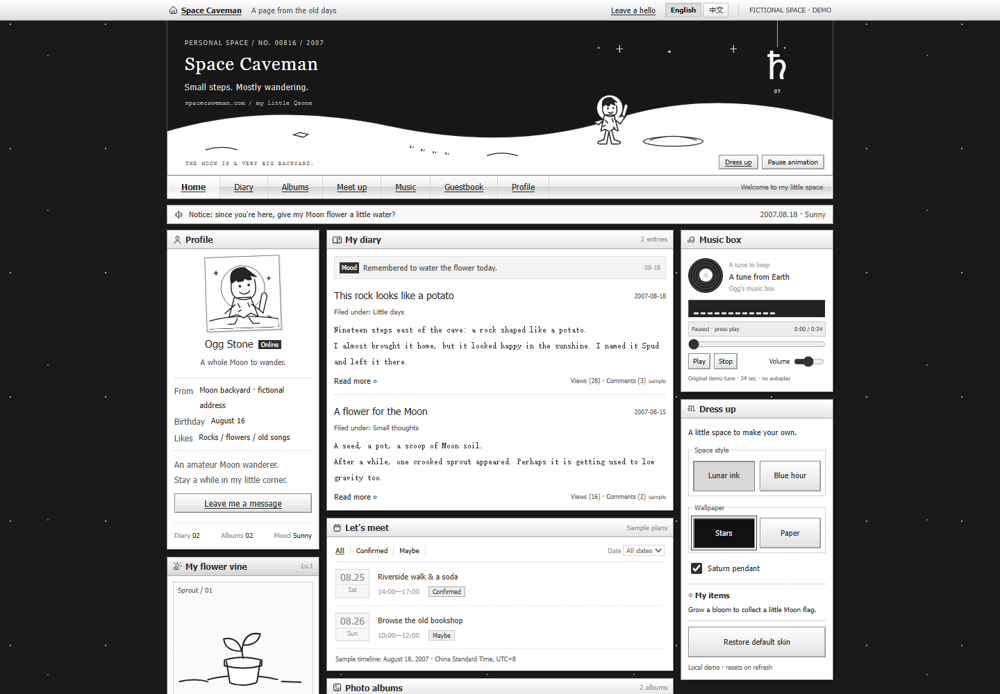
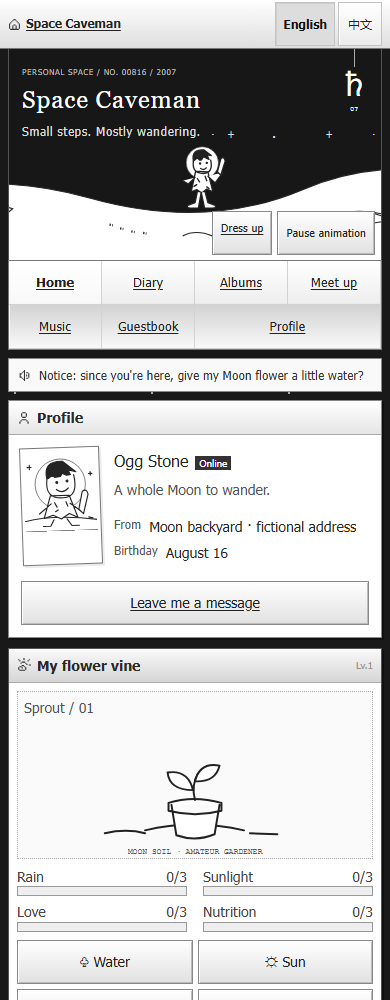

# Lunar Qzone skin

This records the earlier full-homepage design and its verification. The current
[three-module homepage](three-module-homepage.md) keeps this skin and header, but
mounts only NYC status, flower and visitor count. Dress-up controls and the other
content modules are retained in source; their historical tests are archived in
`demo/previous-homepage-tests/`. Current flower behavior is documented in
[the production guide](homepage-production.md): daily resets, bars without
numeric progress, and no flag reward. The gadget descriptions below are historical.

Implements [issue #15](https://github.com/QFREEE/spacecaveman/issues/15). The owner
authorized implementation and a pull request after reviewing the research. We
proceeded with the recommended balanced black/white composition rather than a
separate three-option selection round.

The homepage retains Qzone's compact utility bar, horizontal navigation, notice,
independent frames, unequal column heights, bitmap icons, gradient title bars,
beveled buttons, dotted rules, diary, albums, meetups, music, guestbook and sample
counter. Original simple line drawings supply the Moon/caveman skin. This is a
period-inspired adaptation, not an exact recovery of a Tencent skin.

[Full desktop composition](screenshots/lunar-desktop-full.png).

## Gadgets

- **Flower vine:** Water, Sun, Prune and Feed increase Rain, Sunlight, Love and
  Nutrition respectively from 0 to 3. Growth follows their minimum: sprout,
  leaves, bud, bloom. Water immediately darkens the soil even when another
  attribute limits growth. Each action has a distinct short decorative response.
  Repeated activation is blocked during that response; full attributes explain
  the cap. Reset clears the plant, response and session care log.
- **Properties / log:** shows the simplified-rule explanation and up to 12 care
  actions from the current page. Numeric meters are always visible.
- **Dress up:** switch star/paper wallpaper, place/remove the Saturn pendant,
  and restore the default lunar skin. The Lunar ink / Blue hour style selector is
  temporarily hidden; its registry and palettes remain available for future use.
  Bloom unlocks a place/remove Moon flag. Plant reset
  retains an earned flag; page refresh clears all rewards and dress-up state.
- **Motion:** bounded stepped caveman walk and gentle pendant swing. The visible
  pause control stops both. Reduced motion gives still artwork and immediate
  care outcomes. No autonomous game progress, decay, daily lockout or purchases.
- **Music box:** the disc and equalizer move only while the audio reports
  playback. Pause, buffering, end and errors stop them. The original local tune
  never autoplays; reduced motion keeps the player fully functional.

Flower/dress-up/guestbook state exists only in React memory and survives language
switches. English is the initial language; Chinese labels, status messages,
fixtures and metadata are translated. No accounts, new API calls, analytics,
notifications or server writes were added. The visitor counter is sample data.

## Mobile and tests

At 720px and below the columns become one visual reading sequence, with the
compact profile and flower before the diary. The 320px care controls stay in a
two-by-two group with 44px targets; body copy is at least 14px and form controls
use 16px text. The horizon is recomposed for phones instead of scaling down a
desktop canvas. Normal browser zoom remains enabled.

Source order matches that phone sequence, including Albums → Music → Dress up →
Guestbook → Visitors. No CSS `order` or positive `tabindex` changes keyboard flow.
Desktop grid places Guestbook and the decorative counter in the lower row, while
retaining three compact columns and the original artwork.

Verified for the previous full homepage: 44 active Chromium browser tests (desktop and touch-phone projects),
with 2 theme-switching cases skipped while the public selector is hidden,
10 existing backend regressions, JavaScript checks, TypeScript/Vite build, website
and isolated presence Worker dry-run packaging. Tests exercise growth thresholds,
each care attribute, caps, burst-click protection, reset/refresh, reward placement,
both languages, keyboard care, reduced motion, ambient pause, real audio states,
guestbook validation, literal user text, albums, filters, source/visual order,
real Tab transitions, zero network writes and
overflow at 320/390/430/720/800/1440px. Physical iOS/Android devices were not tested.

Run `pnpm demo:dev` for local preview, and `pnpm demo:test` for browser checks.
Set `DEMO_TEST_PORT` if port 4173 is already in use. The existing CI workflow runs
these checks on the PR and again after merge; successful `main` checks deploy to
https://spacecaveman.com. Opening this PR does not itself replace production.

## Evidence and ownership

The [gadget research](qzone-gadgets-research.md) and
[flower follow-up](qzone-flower-followup-research.md) distinguish early desktop
evidence from the supplied 2022 article's later mobile controls. The four direct
care mappings and 0–3 levels are our explicit demo rules. Original artwork and
icon/audio provenance are recorded in [ASSETS.md](../demo/ASSETS.md).

`FlowerVine.tsx` owns plant state and reports bloom to the page. `DressUp.tsx`
renders local settings; `LunarScene.tsx` contains decorative artwork only.
`themes/registry.ts` registers palette/scene/portrait choices, `ThemeProvider.tsx`
owns selection, `themes/lunar.css` preserves the accepted palette, and
`styles/space.css` supplies the shared composition and motion. Existing modules
and backend contracts stay separate. See [theme extension instructions](themes.md)
and the saved design tag `design/lunar-qzone-v1`.
