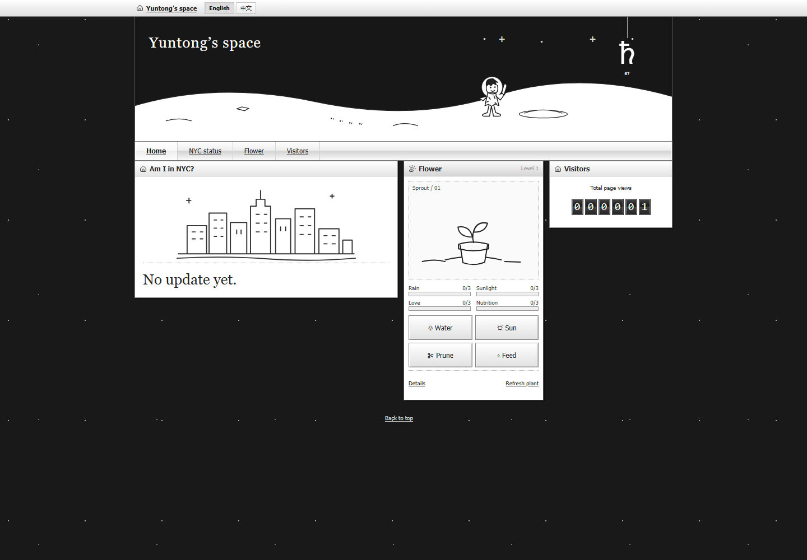
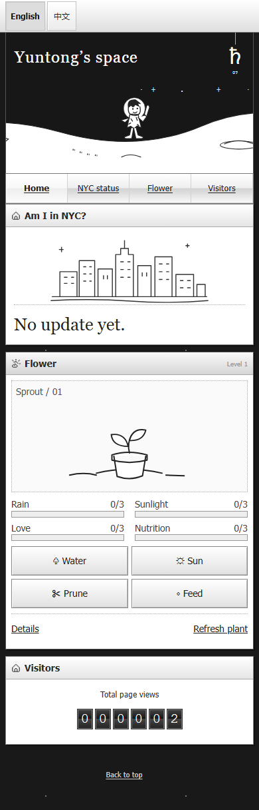

# Three-module homepage

The production homepage is **Yuntong’s space**, with exactly **Am I in NYC?**,
**Flower**, and **Visitors**. It keeps the monochrome lunar header and compact
retro frames. The old fictional badge, notice, footer copy, sample counter and
public reset control are retired.

## Current behavior

- NYC status reads `/api/presence/public`, without browser credentials. An active
  authorized report selects the city/train or woods/figure reveal. Answers are
  “Yes, I’m in NYC!”, “No, I am in the woods.” and “No update yet.” The woods answer
  is the owner's playful wording for the outside-NYC state, not precise tracking.
  Missing, expired or revoked reports remain unknown. Approximate update age is
  shown without exact timestamps. The private phone write API stays authenticated.
- The answer is accessible immediately. Scene and text settle after 1.2 seconds;
  reduced motion or the retained `.motion-off` hook shows the final state at once.
  Resuming motion or switching language does not replay a settled scene. The
  owner's newer homepage has no visible pause button.
- Flower care persists in D1 and is shared across visitors, with independent
  0–3 stats, atomic cooldown, bloom reward and next-day replant. Visitors cannot
  reset another person's progress. The flag visibility preference is browser-local.
- The counter reads and increments the aggregate page-load count. It never
  substitutes the former 001286 sample when unavailable.
- Typed English and Chinese catalogs cover metadata, feedback and accessibility.
  Switching language preserves the current plant and its history.

Desktop uses three uneven columns; at 720px and below they stack in NYC → Flower
→ Visitors order. Retired prototype components remain unmounted and use a separate
legacy translator.

## Deployment regression and verification

Tracked in #39. The newer production work was previously present only in the
original checkout. PR #37 and #38 were based on the older committed demo, so their
successful deployment restored that demo. The corrective change reconciles the
production source into Git and makes the checked-in build the release source.

`pnpm verify` checks backend behavior, the frontend build, desktop/phone browser
scenarios and both Worker packages. Browser cases cover real API fixtures,
bilingual state, report expiry, scene timing, reduced motion and responsive layout.

`scripts/verify-deployment.mjs` compares the public HTML and JS/CSS assets with
`dist/site`, checks the public API contracts, and checks that private/retired
routes remain protected. It uses GET requests only. A successful HTML response
alone cannot pass verification with the old demo or stale frontend assets.

The earlier screenshots in `docs/screenshots/home-desktop.png` and
`home-phone.png` document the old demo layout; they are historical references.
See [production behavior](homepage-production.md), [bilingual messages](bilingual-homepage.md)
and [publishing](qzone-publishing.md).
Local package previews (isolated SQLite data):

