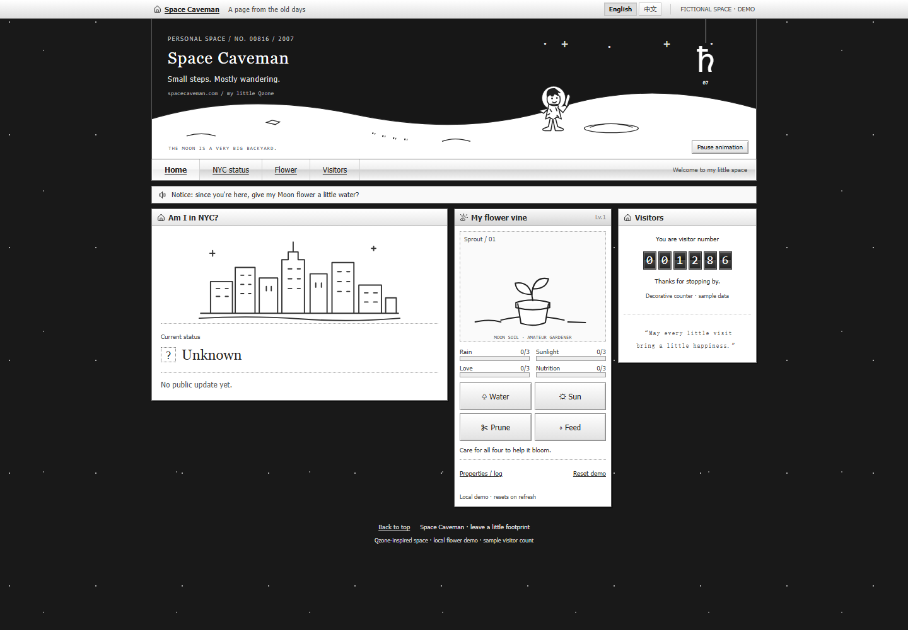
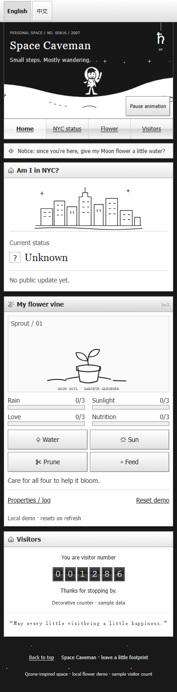

# Three-module homepage

Historical design milestone: the current homepage now uses live presence, shared
flower storage and real page views. See [production behavior](homepage-production.md)
and the [bilingual editing guide](bilingual-homepage.md). The behavior and screenshots
below describe the earlier demo milestone.

Implements [issue #22](https://github.com/QFREEE/spacecaveman/issues/22). The front
page now contains exactly **Am I in NYC?**, **My flower vine**, and **Visitors**.
It retains the accepted monochrome lunar Qzone header, compact framed modules,
bitmap icons, beveled controls, English default and Chinese language switch.

The screenshots below show the original layout before the NYC answer reveal.

## Behavior

- NYC status shows **No update yet.** with a subtle 1.2-second fade and upward
  settle on page load. The answer stays visible and is available to screen readers
  immediately. Pausing animation or requesting reduced motion shows it immediately.
  With an in-NYC status, a small train arrives in the skyline; with an outside-NYC
  status, a figure appears among trees. Both scenes settle after 1.2 seconds.
  The woods are a playful symbol for being outside NYC, not a location report.
  Unknown status keeps a quiet skyline without either scene. Pausing or reduced
  motion immediately settles the scene; resuming does not replay it.
  English and Chinese copy support all three states; the public default remains
  unknown. The existing presence
  trial is private and credential-protected; this card makes no request to it,
  exposes no credential, and does not infer a yes/no status. Connecting a public
  status requires a separate integration decision.
- Flower care retains Water, Sun, Prune and Feed, independent 0–3 attributes,
  minimum-based growth, immediate feedback, caps, burst protection and the local
  care log. Bloom earns and places the Moon flag. Its checkbox is inside the
  flower module; plant reset retains the reward, and refresh resets all state.
- The visitor count **001286** remains decorative, explicitly labeled sample
  data. It does not measure visits. No analytics or backend changes are included.
- Language changes preserve care and reward state. Ambient animation can be
  paused; reduced-motion preferences give still decoration and immediate care.

The main content source order is NYC → Flower → Visitors. Desktop uses three
uneven columns; at 720px and below they stack in the same order. Phone copy is
readable and care controls keep 44px targets. Navigation links target only the
remaining sections.

## Implementation and preservation

`demo/src/main.tsx` composes `NycStatus.tsx`, `FlowerVine.tsx` and
`VisitorCounter.tsx`. `styles/home.css` supplies the composition using the existing
theme tokens. The style selector stays hidden. Theme registry, palettes and the
saved design tag `design/lunar-qzone-v1` remain available.

Profile, diary, meetups, albums, music, guestbook and dress-up components remain
in source but are not mounted or linked. Their prior browser scenarios are kept
in `demo/previous-homepage-tests/`, outside Playwright's active `demo/e2e/`
directory. These are historical coverage, not evidence for the current page.
The complete previous composition is recoverable from Git commit
`35b19bd5d215caee92f22edd027f2af7d62b5b40`.

## Verification

Run `pnpm demo:build` and `pnpm demo:test`; set `DEMO_TEST_PORT` if 4173 is occupied.
The active Chromium checks cover desktop and touch-phone projects: exact
module count, no API requests, sample labeling, valid links, bilingual state,
real Tab order, care stages/caps/reward/reset, burst protection, pause/reduced
motion, enlarged text and overflow at 320/390/430/720/1440px. Screenshots above
were inspected at desktop and 390px phone widths. Physical iOS/Android testing
remains outstanding. Existing Worker checks and deployment packaging remain in CI.

`node scripts/qzone-deploy-smoke.mjs <base-url>` also checks the complete Worker
package's security headers, three modules, bilingual flower interactions and
preserved routes; follow the [publishing guide](qzone-publishing.md) to start it.

The outside-NYC answer is the owner's playful wording: **Nope! Chilling in the woods**
(**不在，我在树林里。**). The status remains a coarse outside-NYC value; the wording
does not introduce more precise location data.
